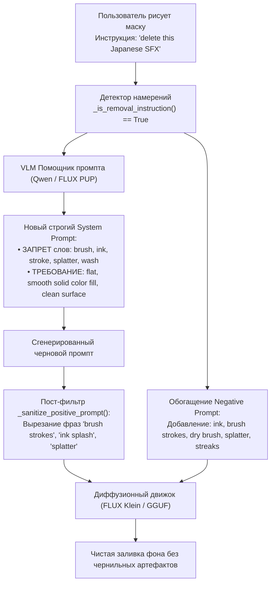

# Техническое задание (ТЗ)
## Устранение артефактов чернил и мазков кисти («Ink Brush Artefacts») при Inpaint

* **Проект:** QuantFunc WebUI (`LazySD-UI`)
* **Дата составления:** 03 ноября 2026 г.
* **Статус документа:** Готово к реализации / На согласовании
* **Область воздействия:** Inpaint Studio, VLM Prompt Helper, Heuristic Fallback, Negative Prompting

---

## 1. Описание инцидента и визуальные доказательства

### 1.1. Суть проблемы
При попытке удаления японских звуковых эффектов (SFX), надписей или облачков текста с помощью инструмента Inpaint («Стереть SFX / текст»), диффузионная модель генерирует поверх маски **грубые мазки чёрной туши, разбрызганные капли («splatter»), полосы сухой кисти («dry-brush streaks») и тёмно-багровые кляксы**.

### 1.2. Визуальные свидетельства
Пользователь зафиксировал дефект на холсте Inpaint Studio (масштаб 100% и детальный зум 221%):

| Общий вид холста (масштаб 100%) | Детальный вид артефактов (зум 221%) |
| :---: | :---: |
|  |  |

На скриншотах отчётливо видно:
1. Вместо заливки фоновым цветом подложки (сине-фиолетовый фон сцены) область маски заполнена тёмно-красным пятном.
2. Внутри пятна прорисованы контрастные чёрные мазки и чернильные брызги, напоминающие текстуру кисти манги.

---

## 2. Анализ первопричины (Root Cause Analysis)

### 2.1. Анализ метаданных генерации
Изучение логов и JSON-манифеста генерации ([`outputs/nunchaku_20261103_031830_1793657910.json`](file:///G:/QuantFunc-WebUI/outputs/nunchaku_20261103_031830_1793657910.json)) выявило реальный сгенерированный промпт:

```json
{
  "prompt": "A seamless dark red and black ink-splash background filling the entire area, with dense crimson washes, irregular black brush strokes, dry-brush streaks, scattered droplets, and rough manga-style splatter matching the surrounding artwork. The central region contains only the continuous painted texture, with no lettering, symbols, characters, masks, or foreground objects.",
  "negative_prompt": "text, japanese, kanji, kana, letters, sfx, speech bubble outline, watermark, signature, seams, blurry, low contrast, color shift, japanese sfx, katakana, speech bubble, visible seam"
}
```

> [!CAUTION]
> **Критический факт:** Диффузионная модель не ошиблась. Она выполнила промпт буквально:
> * `"black ink-splash background"` (фон из брызг чёрных чернил)
> * `"dense crimson washes"` (густые багровые размывки)
> * `"irregular black brush strokes"` (неровные чёрные мазки кисти)
> * `"dry-brush streaks"` (полосы сухой кисти)
> * `"scattered droplets, rough manga-style splatter"` (разбрызганные капли и грубые брызги)

### 2.2. Почему VLM (Помощник промпта) сгенерировал такой промпт?
В предыдущем коммите в файле [`backend/vision_runtime.py`](file:///G:/QuantFunc-WebUI/backend/vision_runtime.py#L550-L570) системный шаблон для режима удаления (`is_removal == True`) содержал инструкцию:

```python
req_text = (
    f"Task: {instr_clean}. "
    "Write ONLY a direct visual description (20-35 words) of the clean background surface, "
    f"colors ({colors or 'matching surrounding tones'}), lighting, and manga/anime brush texture "
    "that should fill this area. Do NOT mention characters, red masks, images, or hex codes."
)
```

1. **Фраза-провокатор `"manga/anime brush texture"`:**
   Модель машинного зрения (Qwen2.5-VL / FLUX.3 PUP), видя вокруг маски контуры манги и тушь, расценила указание «описать текстуру кисти манги» как прямое требование описать *мазки туши, сухую кисть и брызги*.
2. **Захват красного цвета из маски/SFX:**
   Оригинальный SFX содержал багрово-красную штриховку. Анализатор цвета зафиксировал «crimson / red», а VLM соединила это с «brush texture» и выдала «crimson washes and black ink strokes».
3. **Отсутствие чернил в Negative Prompt:**
   В негативном промпте фильтровались `text, sfx, kanji, speech bubble`, но полностью отсутствовали стоп-слова для туши и мазков: `ink, brush strokes, dry brush, splatter, droplets, streaks, black marks`.
4. **Статус pre-healing (`heal_masked_image`):**
   Проверка массива пикселей в файле инициализации [`outputs/masks/nunchaku_init_1793657910_28788.png`](file:///G:/QuantFunc-WebUI/outputs/masks/nunchaku_init_1793657910_28788.png) подтвердила: внутри маски цвета были сглажены (`mean RGB: [79.5, 54.0, 75.1]`, чёрных пикселей 0,0,0 не было). Артефакты возникли **на 100% из-за текста промпта**.

---

## 3. Архитектура решения



---

## 4. Спецификация изменений по модулям

### 4.1. Модуль генерации промптов (`backend/vision_runtime.py`)

#### 4.1.1. Обновление System Prompt (`INPAINT_PUP_SYSTEM_PROMPT`)
Для задач удаления текста, SFX и объектов полностью запретить любые упоминания художественных инструментов:

```text
CRITICAL REMOVAL RULES:
1. When removing/deleting text, SFX, speech bubbles, or artifacts:
   Describe ONLY a completely FLAT, CLEAN, SMOOTH, UNIFORM background surface.
2. STRICTLY FORBIDDEN WORDS:
   NEVER output words: "brush", "stroke", "strokes", "ink", "splatter", "spray", 
   "droplet", "droplets", "wash", "washes", "streak", "streaks", "dry-brush", "texture".
3. The replacement area MUST be described as plain, solid, or smooth gradient background matching surrounding art.
```

#### 4.1.2. Обновление шаблона пользовательского запроса (`req_text`)
Заменить:
```python
# БЫЛО (вызывало галлюцинации мазков туши):
"Write ONLY a direct visual description (20-35 words) of the clean background surface, "
f"colors ({colors or 'matching surrounding tones'}), lighting, and manga/anime brush texture that should fill this area."
```
На:
```python
# СТАЛО:
"Write ONLY a direct visual description (15-25 words) of a flat, smooth, clean background fill "
f"in uniform colors ({colors or 'matching surrounding tones'}). "
"Do NOT describe any brush strokes, ink, splatter, or character details. Keep it plain and clean."
```

---

### 4.2. Модуль санитизации промптов (`backend/vision_runtime.py`)

В функцию `_sanitize_positive_prompt(prompt_raw, is_removal=False)` внедрить регулярные выражения, принудительно вырезающие фразы-артефакты:

```python
_INPAINT_ARTEFACT_PATTERNS = [
    r"\b(?:irregular\s+)?black\s+brush\s+strokes?\b",
    r"\b(?:dry[- ]brush|brush[- ]strokes?|brushwork|brush\s+texture)\b",
    r"\b(?:ink[- ]splash|ink[- ]wash(?:es)?|ink\s+splatter|ink\s+marks?|ink\s+droplets?)\b",
    r"\b(?:rough|dense|layered)\s+manga[- ]style\s+splatter\b",
    r"\b(?:splatter|splashes|droplets|streaks|stains|smudges)\b",
    r"\b(?:crimson|red|dark)\s+washes\b",
]
```

Если обнаружено удаление SFX, очищенный промпт автоматически дополняется маркерами чистоты:
`"clean smooth flat background, seamless solid fill, uniform tone"`.

---

### 4.3. Модуль отрицательных промптов (`backend/vision_runtime.py` и `backend/prompt_fallback.py`)

В `_sanitize_negative_prompt` для задач удаления SFX/текста гарантированно добавлять токены подавления чернил и мазков:

```python
_MANDATORY_REMOVAL_NEGATIVES = [
    "ink",
    "brush stroke",
    "brush strokes",
    "dry brush",
    "splatter",
    "droplets",
    "ink wash",
    "streaks",
    "black marks",
    "dark spots",
    "dirty shading",
    "grunge",
]
```

---

### 4.4. Модуль эвристического фоллбэка (`backend/prompt_fallback.py`)

В шаблоне `generate_heuristic_prompt` заменить формулировку:
* **Было:** `"...manga brush and illustration texture, clean edges, no text..."`
* **Стало:** `"...flat smooth clean background surface, uniform color fill, seamless solid backdrop, no ink, no brush marks..."`

---

### 4.5. Модуль интерфейса (`frontend/js/app.js`)

1. **Дефолтный Negative Prompt вкладки Inpaint:**
   Обновить базовое значение отрицательного промпта в поле `inpaint-negative-prompt`:
   ```text
   text, japanese, kanji, kana, letters, sfx, ink, brush strokes, splatter, streaks, dark spots, speech bubble outline, watermark, signature, visible seams
   ```
2. **Чекбокс «Чистая заливка»:**
   В блоке Помощника промпта предусмотреть опцию:
   `[x] Плоская заливка (без мазков и фактуры)`, активную по умолчанию при удалении SFX.

---

## 5. План тестирования и критерии приёмки (Acceptance Criteria)

| № | Сценарий проверки | Критерий успешности |
|---|---|---|
| **AC-1** | Генерация промпта VLM на тестовом кадре с японским SFX | В промпте отсутствуют слова `brush`, `stroke`, `ink`, `splatter`. Промпт описывает ровный цвет фона. |
| **AC-2** | Принудительная вставка слов `black brush strokes, ink splatter` в черновик | Санитизатор `_sanitize_positive_prompt` полностью вырезает их перед отправкой в диффузию. |
| **AC-3** | Генерация Inpaint на Nunchaku SVDQ (Flux.2 Klein 9B) | На месте удалённого SFX получается ровная заливка, совпадающая с окружающим артом, без чёрных пятен и брызг. |
| **AC-4** | Генерация Inpaint на SD.CPP (GGUF Flux 3 Klein) | Шов маски гладкий, без ореолов и без текстурного шума. |

---

## 6. Резюме

| Параметр | Текущее состояние (Ошибка) | Целевое состояние по ТЗ |
|---|---|---|
| **Запрос к VLM** | `"manga/anime brush texture"` | `"flat, smooth, clean background fill, zero brush strokes"` |
| **Сгенерированный промпт** | `"irregular black brush strokes, dry-brush streaks, splatter"` | `"seamless smooth background, uniform tone, clean backdrop"` |
| **Negative Prompt** | Только `text, kanji, sfx` | `text, sfx, ink, brush strokes, dry brush, splatter, streaks` |
| **Результат на холсте** | Чёрные кляксы и полосы туши | Чистая поверхность фона без следов |
