# Техническое задание (ТЗ)
## Исправление отображения результата генерации с маской на холсте («Результат не добавляется, однако он есть»)

* **Проект:** QuantFunc WebUI (`LazySD-UI`)
* **Дата составления:** 03 ноября 2026 г.
* **Статус документа:** Готово к реализации / На согласовании
* **Область воздействия:** Вкладка «Генерация» (`genMask`), Студия Inpaint (`applyInpaintResult`), `showPreview`, синхронизация источника холста

---

## 1. Описание инцидента и визуальные доказательства

### 1.1. Суть проблемы
Пользователь запускает генерацию с маской (inpaint/редактирование выделенной области). 
* Процесс генерации завершается успешно (`100%`, уведомление «Генерация завершена»).
* На сервере файл создаётся, сохраняется в директорию `outputs/` и корректно отображается в модальном окне «История».
* **Однако на холсте результат не появляется:** рабочая область продолжает показывать исходное изображение, поверх которого по-прежнему нарисована старая маска.

### 1.2. Визуальные свидетельства
Пользователь предоставил два скриншота, подтверждающих рассинхронизацию интерфейса:

| 1. Вкладка «Генерация» (холст НЕ обновился) | 2. Модальное окно «История» (результат ЕСТЬ) |
| :---: | :---: |
|  |  |

#### Что зафиксировано на скриншотах:
1. **Скриншот 1 (Вкладка «★ Генерация»):**
   * Активен режим плавающей маски `🎭 Маска` с надписью `Источник: nunchaku_20261103_015022_17...`.
   * На холсте отображается старый исходник с красной маской поверх японского звука «ア».
   * Сгенерированный кадр **не подставился** на холст.
2. **Скриншот 2 («Детали генерации» в Истории):**
   * Файл `nunchaku_20261103_015022_1793652622.png` **реально сгенерирован** (время: 46.97s, разрешение: 2800×4024).
   * На превью в истории видно, что звук «ア» успешно заменён на персонажа с красными волосами.
   * Файл физически существует на диске, но UI вкладки «Генерация» его проигнорировал.

---

## 2. Анализ первопричины (Root Cause Analysis)

### Причина 1: Жёсткая блокировка обновления `preview-img` в `showPreview`
В файле [`frontend/js/app.js`](file:///G:/QuantFunc-WebUI/frontend/js/app.js#L3210-L3220) функция отображения готового результата содержит условие:

```javascript
showPreview(imagePath) {
    ...
    const filename = imagePath.split(/[\/\\]/).pop();
    const url = `/outputs/${encodeURIComponent(filename)}?t=${Date.now()}`;
    
    // КРИТИЧЕСКИЙ БАГ:
    if (!this.state.genMask?.enabled) img.src = url;
    
    this.state.currentPreviewFilename = filename;
    this.state.currentPreviewUrl = url;
    ...
}
```

> [!CAUTION]
> **Прямая блокировка:**
> Если у пользователя включён режим маски на вкладке Генерации (`this.state.genMask?.enabled === true`), строка `img.src = url` **НЕ ВЫПОЛНЯЕТСЯ ВООБЩЕ**!
> В результате тег `` предпросмотра остаётся со старым изображением.

---

### Причина 2: Отсутствие вызова обновления источника маски в `pollJob`
Когда генерация завершается, в обработчике опроса (`frontend/js/app.js:3037`):

```javascript
if (status.status === "complete") {
    this.stopPolling();
    this.setGenerating(false);
    this.showPreview(status.image_path);
    this.toast("success", t("toast.generation_complete"));
}
```

* Вызывается только `showPreview(status.image_path)`.
* При этом для `genMask` **не вызывается** ни обновление источника `setGenMaskSource()`, ни очистка холста маски (`surface.clear()`).
* Состояние `genMask.source` продолжает указывать на старое изображение, плашка виджета продолжает писать старое имя файла, а нарисованная маска остаётся поверх не изменившегося холста.

---

### Причина 3: Конфликт токенов в Студии Inpaint (`applyInpaintResult`)
В Студии Inpaint обнаружена аналогичная проблема отсечения результата:

```javascript
// frontend/js/app.js:13894 и 13924:
if (
    !context
    || state.jobId !== context.jobId
    || state.source?.token !== context.sourceToken
    || state.sourceLoadSeq !== context.sourceToken // ОШИБКА: сравнение счётчика со строковым токеном
) {
    state.jobContext = null;
    this.toast("warning", this.maskT("inpaint.hint.source_changed", "Источник изменился; результат не добавлен"));
    return;
}
```

Если пользователь перед генерацией обновил файл или произошла повторная инициализация, условие `state.sourceLoadSeq !== context.sourceToken` ложно срабатывает и молча сбрасывает готовый результат без добавления слоя.

---

## 3. Архитектура решения и жизненный цикл завершения генерации

```mermaid
sequenceDiagram
    autonumber
    participant Backend as FastAPI Backend (/api/jobs)
    participant Poll as Frontend pollJob()
    participant Preview as showPreview()
    participant GenMask as genMask Engine
    participant Canvas as Canvas / Viewport DOM

    Backend-->>Poll: status = "complete", image_path = "outputs/nunchaku_...png"
    Poll->>Preview: showPreview("nunchaku_...png")
    
    rect rgb(20, 45, 30)
    Note over Preview,Canvas: Новая логика применения результата
    Preview->>Canvas: Обновить img.src = url (ВСЕГДА, включая режим genMask)
    Preview->>GenMask: Если genMask.enabled == true: вызвать onGenMaskComplete(url, filename)
    GenMask->>GenMask: 1. Установить новый сгенерированный файл источником (setGenMaskSource)
    GenMask->>GenMask: 2. Очистить маску (surface.clear()) или сохранить в Undo-историю
    GenMask->>Canvas: 3. Обновить виджет "Источник: [новое имя]", сбросить "Покрытие: 0%"
    end

    Poll->>Canvas: Toast "Генерация завершена ✓"
```



---

## 4. Спецификация изменений по модулям

### 4.1. Вкладка «Генерация»: Метод `showPreview` (`frontend/js/app.js`)

#### 4.1.1. Снятие блокировки с `preview-img`
Удалить условие `if (!this.state.genMask?.enabled)`:
* Элемент `#preview-img` **обязан** обновлять `src` на полученный `url` при любом завершении генерации.

#### 4.1.2. Интеграция с `genMask`
Внутри `showPreview(imagePath)` добавить проверку активности маски:
```javascript
if (this.state.genMask?.enabled) {
    this.handleGenMaskJobComplete({
        url: url,
        filename: filename,
        path: filename,
    });
}
```

---

### 4.2. Модуль маски генератора: `handleGenMaskJobComplete` (`frontend/js/app.js`)

Создать выделенный метод обработки завершения генерации с маской:

1. **Бесшовное переключение источника:**
   * Автоматически вызвать `setGenMaskSource({ url, path, name: filename })`.
   * Обновить заголовок в плавающем окне: `Источник: <новое_имя_файла>`.
2. **Очистка использованной маски:**
   * Так как генерация по текущей маске уже выполнена, старая маска на холсте больше не актуальна.
   * Вызвать `state.surface.clear()`, пересчитать процент покрытия (должно стать `0%`).
   * Сохранить предыдущее состояние в стек Undo, чтобы пользователь при желании мог нажать `↶ Отмена` и вернуть прежнюю маску.
3. **Синхронизация геометрии:**
   * Вызвать `syncGenMaskGeometry()`, чтобы холст маски в точности соответствовал новым размерам изображения.

---

### 4.3. Студия Inpaint: Метод `applyInpaintResult` (`frontend/js/app.js`)

1. **Исправление валидации контекста источника:**
   * Заменить некорректное условие `state.sourceLoadSeq !== context.sourceToken` на строгую проверку соответствия пути:
     ```javascript
     const sourceMatches = state.source && (
         state.source.path === context.sourcePath ||
         state.source.token === context.sourceToken
     );
     if (!sourceMatches) {
         // предупреждение только при реальной смене файла пользователем
     }
     ```
2. **Гарантированное добавление слоя:**
   * При успешной загрузке `fragmentUrl` слой типа `result` немедленно пушится в `state.layers`, вызывается `renderInpaintComposite()` и `renderInpaintLayersUI()`.

---

### 4.4. Интеграция с Историей («Редактировать в Img2Img» / «Передать в Маску»)

При нажатии кнопок в деталях истории (`openHistoryItemInTool`):
* Если открывается вкладка `generate` с активным режимом `genMask`:
  * Гарантированно устанавливать выбранное изображение в качестве активного источника маски через `setGenMaskSource()`.

---

## 5. План тестирования и критерии приёмки (Acceptance Criteria)

| № | Сценарий проверки | Ожидаемый результат |
|---|---|---|
| **AC-1** | Генерация на вкладке «Генерация» с включённой маской `🎭 Маска` | По завершении генерации холст **мгновенно отображает новый сгенерированный результат**. |
| **AC-2** | Состояние виджета `🎭 Маска` после генерации | Виджет обновляет поле «Источник» на имя нового сгенерированного файла. Процент покрытия сбрасывается в `0%`, красная маска исчезает с холста. |
| **AC-3** | Возможность повторного рисования (Chaining) | Пользователь может сразу поверх нового результата нарисовать новую маску и нажать «Генерация» без ручной перезагрузки страницы. |
| **AC-4** | Студия Inpaint (`applyInpaintResult`) | После завершения генерации в Inpaint создаётся и отображается новый слой «Результат N», перекрывающий выделенную область. |
| **AC-5** | Загрузка из «Истории» | Клик по «Редактировать в Img2Img» из модального окна истории подгружает выбранный файл на холст даже при активном режиме маски. |

---

## 6. Сводная таблица (Было / Станет)

| Компонент | Текущее поведение (Ошибка) | Целевое поведение по ТЗ |
|---|---|---|
| **`showPreview()`** | `if (!genMask.enabled) img.src = url` блокирует показ | `img.src = url` обновляется **всегда** |
| **Источник `genMask`** | Остаётся старый файл (`nunchaku_...015022`) | Обновляется на свежий сгенерированный файл |
| **Маска на холсте** | Старая красная маска остаётся «висеть» | Маска автоматически очищается (уходит в Undo) |
| **Inpaint Studio** | Ложный сброс по `sourceLoadSeq !== sourceToken` | Результат гарантированно создаёт видимый слой |
